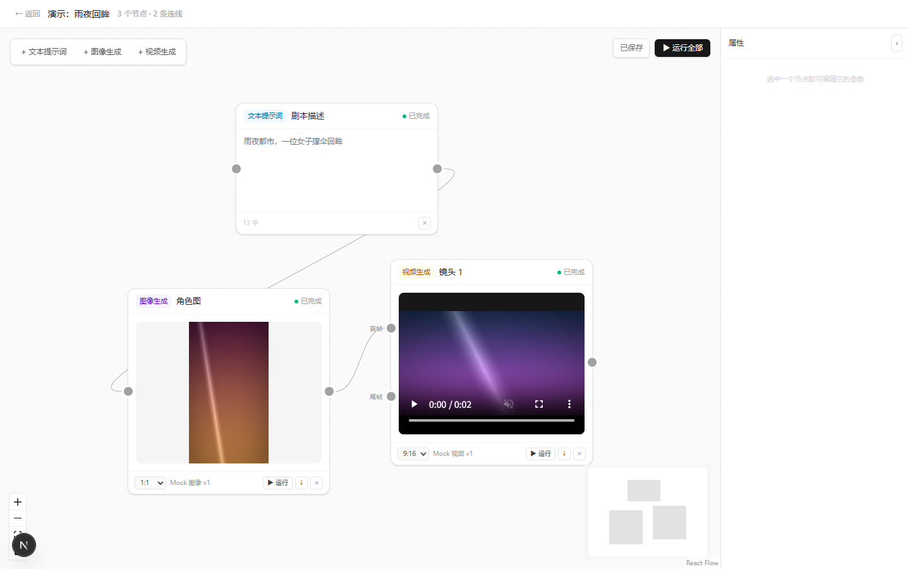

# VideoTV

对标 LibTV 的 AI 视频生产平台：无限画布 + 节点式工作流。

## 技术栈

Next.js 16.4.2 (App Router) · React 19 · TypeScript · Tailwind 4 · Prisma 7 + SQLite
  
· React Flow 12 · Zustand · ffmpeg（Mock 视频编码）

## 快速开始

```bash
npm install
npm run db:migrate     # 建库 + 生成迁移
npm run dev            # http://localhost:3000

# 另开一个终端：模型调用全部在这个进程里跑，不开它点「运行」会一直排队
npm run worker
```

> 需要先有 `.env`（可从 `.env.example` 复制）：
>   
> `DATABASE_URL="file:./dev.db"`

**两个进程缺一不可**：`dev` 负责界面和提交，`worker` 负责实际执行。
  
只开 `dev` 的话，点运行后任务会一直停在「排队中」（界面 3 秒后会提示你去启动 worker）。

## 常用命令

| 命令                    | 作用                       |
| --------------------- | ------------------------ |
| `npm run dev`         | 开发服务器                    |
| `npm run worker`      | 执行 Worker（独立进程，跑模型调用的地方） |
| `npm run build`       | 生产构建                     |
| `npm run db:migrate`  | 开发期建迁移并应用                |
| `npm run db:deploy`   | 生产环境应用迁移                 |
| `npm run db:generate` | 重新生成 Prisma Client       |
| `npm run db:studio`   | 可视化查看数据库                 |

## 开发进度

- [x] **M1 脚手架** — 项目 CRUD、Prisma 建模、数据链路打通
- [x] **M2 画布骨架** — 增删节点、连线、位置持久化、防环检测、三种删除入口 CRUD
- [x] **M3 节点参数编辑** — 选中原地展开表单、注册表驱动字段、防抖自动保存
- [x] **M4 Provider 抽象 + Mock** — 统一模型接口、按能力选模型、真出 PNG / 真编 MP4、原子落盘
- [x] **M5 队列 + Worker + 拓扑排序** — 提交立即返回、按批次执行、乐观锁抢占、SSE 推送、失败跳过下游、取消与断点续跑
- [x] **M6a 右侧属性面板** — 字段类型扩展到 select/number/switch，节点尺寸按类型固定，不再选中变大
- [x] **M6b 两种执行语义** — 单节点运行（复用上游产物）、运行到此处（「运行全部」已于 2026-10-25 删除）
- [x] **M6c 节点能力** — 画面比例/模型/时长（选项来自模型声明）、首帧·尾帧具名端口、下载
- [x] **M6d 创作台形态** — 节点主体改为产物大预览，常用参数落在卡片底栏
- [ ] M6e 文本动作（润色 / 拆分镜）卡片入口与验收
- [ ] 资产库与运行历史



## 接入真实模型

业务代码不依赖任何具体模型。接一家新模型只需两步：

```ts
// 1. 在 src/providers/ 下实现接口
export function createKlingProvider(cfg): ModelProvider {
  return {
    id: "kling.v1",
    label: "可灵 v1",
    capabilities: ["video"],
    async generate(req) {
      // 提交任务 → 轮询 → 拿到临时 URL
      return { kind: "video", mimeType: "video/mp4", ext: "mp4", remoteUrl: url };
    },
  };
}

// 2. 在 src/providers/registry.ts 注册一行
registerProvider(createKlingProvider({ apiKey: process.env.KLING_KEY! }));
```

`remoteUrl` 会被 `assetService` 当场下载进 `./storage` 归档 ——
  
真实视频 API 给的链接通常几小时就过期，不能直接存进数据库。

## 注意事项

- Next 16 启用 Cache Components，**不要写 `export const dynamic`**，会编译报错
- 读数据库的组件必须包在 `<Suspense>` 里，或用 `export const instant = false`
- SQLite 的 `dev.db` 生成在**项目根目录**
- dev 访问用 `http://localhost:3000`（`127.0.0.1` 需 `allowedDevOrigins`，已配好）
- 节点内的输入框必须带 `nodrag nopan nowheel`，否则会被画布手势吃掉
- 节点参数一律走 `useDebouncedCommit`，不要直接受控绑 store
- 生成的产物在 `./storage/assets/YYYY/MM/`，数据库只存元数据；读取走 `/api/assets/<id>`（支持 Range）
- **状态写进数据库不等于前端看得见**：前端只认 SSE 事件，任何状态变更都要同时 `emit`
- Worker 与 Next 是两个进程，**不共享内存**；跨进程通信只能走数据库（`RunEvent` 表）
- 抢任务必须用 `updateMany({ where: { status: "pending" } })` 判 `count`，不能用 `if + update`
